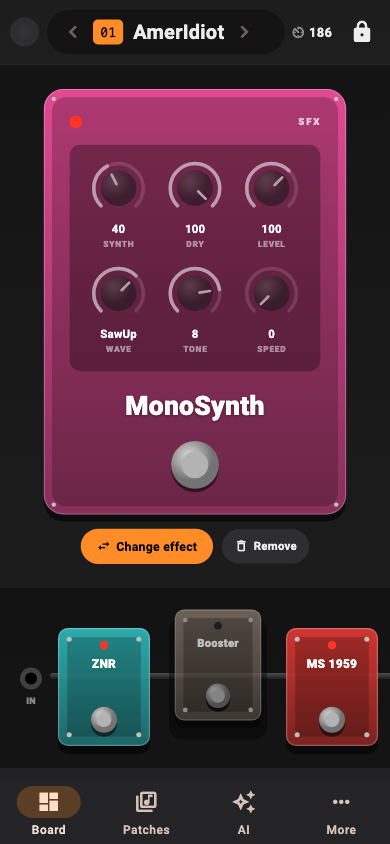

# MS-100BT Link

**A modern editor for the Zoom MS-100BT MultiStomp, on your Mac or Android phone, over Bluetooth.** Version 1.0.

Zoom only made an iPhone app for this pedal, and it disappeared years ago. MS-100BT Link brings the pedal back
to life: see your patches as a real pedalboard, turn knobs live, back up all 50 patches, install extra effects,
drive it from a MIDI footswitch, and describe a sound to an AI that builds the patch for you.


[](docs/media/promo.mp4)

▶ **[Watch the tour](docs/media/promo.mp4)** (a guitarist, a Bluetooth footswitch, the Mac and Android apps, a minute long)

> **Unofficial.** Not affiliated with or endorsed by Zoom Corporation. "Zoom" and "MultiStomp" are trademarks
> of their owners. Editing writes to your pedal, so back up first. The app never sends firmware commands.

---

## What it does

### A real pedalboard
Your patch is laid out as a signal chain: **IN → six stompboxes → OUT**. Each effect is drawn as a pedal in its
category's color, with an LED and a footswitch. Effects that are off lift off the cable and fade out. Click any pedal to
open it large, with knobs you drag up and down (double-click resets to the default) and switches for two-way settings.
The pedal's own screen follows along when you switch effects from the app.

### Live editing, both ways
Every change plays on the pedal instantly. Change something on the pedal itself and the app updates too (live updates
hold the pedal's edit mode and re-read the patch every couple of seconds). Rename patches, set the tempo, swap effects,
and remove them.

### 100 effects, one click away
The effect library shows every effect the MS-100BT has, drawn as mini stompboxes, grouped by category, and searchable by
name *or* knob ("tone", "decay").


### More effects on the pedal
The **Effects** window installs extra effects: stock effects from other Zoom MultiStomps and community-made ones,
downloaded from their authors. Every change is checked against the rules learned on real pedals, needs a full backup
first and an explicit risk confirmation, saves copies of everything it changes, and reads each file back.

### Describe a sound, get a patch
The **Tone Assistant** turns words into patches: *"A warm blues crunch with a touch of room reverb"*. It looks up the
pedal's real effects and allowed knob values, proposes a patch as a card, and you click **Try on pedal** to hear it.
"A bit darker" refines it. Patches only use effects already on your pedal; it may suggest others you could install.
It works with **Claude**, **ChatGPT**, or any **OpenAI-compatible** service (Ollama, LM Studio, OpenRouter) using your
own API key, kept in the system keychain. Nothing is saved on the pedal until you save it.


### Stomp with any MIDI footswitch
Plug in a USB controller or connect a Bluetooth MIDI footswitch (on Android, **Find Bluetooth MIDI** finds paired and
nearby ones and reconnects them next time), tap **Add switch** or **Learn**, and press a switch. **Stomp mode** turns effects
on and off; **Patch mode** loads patches (choose per switch). Momentary and latching switches are detected
automatically, and expression pedals can drive any knob.


### Your patches, safe
**Back up all 50** patches, load any patch, save edits into a slot (only after a backup, with a confirmation that
names what gets overwritten), and import or export `.syx` patch files.

## Platforms

| | |
|---|---|
| **macOS** | The full app, with real windows (Effects, Diagnostics), native menus and alerts. |
| **Android** | The full app on phones and tablets: pairs with the pedal and Bluetooth MIDI controllers in the app. On phones, everything is one tap away in a bottom tab bar: **Board**, **Patches**, **AI**, **More**. |
| **iPhone / iPad** | Not yet: iOS only lets apps use this pedal's Bluetooth through Apple's accessory program. |



## Install

**Mac:** download **MS-100BT-Link-1.0-mac.zip** from [Releases](../../releases/latest), unzip it, and move the app to Applications. It isn't
notarized (that needs a paid Apple developer account), so the first time, **right-click → Open**, or allow it in
*System Settings → Privacy & Security*. It picks up the backups, effect library, settings and AI keys of the earlier
native Mac version automatically.

**Android:** download **MS-100BT-Link-1.0-android.apk** from [Releases](../../releases/latest) and open it (allow
installing from your browser or file manager when asked).

Then, on the pedal: **knob 1 → MENU → Bluetooth → PAIRING**, and in the app use **Scan** / **Pair a new pedal…**, then
**Connect**. Requires macOS 12 or later, or Android 7 or later. Tested with an MS-100BT on firmware 1.30.

## Safety by design

- **A hard allowlist.** Every byte sent to the pedal passes an exact-shape allowlist, in the shared core and again in
  each platform's Bluetooth layer. Firmware and updater commands are blocked outright. The table is in
  [docs/protocol.md](docs/protocol.md).
- **Validated patches.** A patch is only sent if every effect is known and every knob value is in range, and the app
  reads it back to confirm.
- **An editing lock.** Changing the pedal needs an explicit unlock with a warning. Saving to a slot needs a backup of
  that slot and a confirmation.
- **Guarded effect installs.** File changes need a full backup, pass every rule known to keep the pedal safe, and need
  a risk confirmation; the old effect menu is restored if writing the new one fails.
- **The AI can't touch bytes.** The assistant works through typed tools and only *proposes*; you try and save.

How the protocol was worked out, and every finding verified on real hardware:
[docs/updater-findings.md](docs/updater-findings.md).

## Build from source

The app is Flutter (`apps/ms100bt_link`) on a shared, pure-Dart protocol core (`packages/zoom_core`). It builds with
Flutter's `main` channel and the windowing feature (real Mac windows); see
[apps/ms100bt_link/README.md](apps/ms100bt_link/README.md).

```bash
cd packages/zoom_core && dart test          # protocol, codec, allowlist, file system, assistant
cd apps/ms100bt_link && flutter test        # app tests
flutter build macos                          # or: flutter build apk --release
```

The screenshots are rendered from the app with demo data (`test_screens/readme_screenshots_test.dart`), and the promo
video by [promo/](promo/) (drawn frame by frame in SwiftUI, with a soundtrack synthesized from scratch). The earlier
native Swift Mac app and the `zoomprobe` CLI are in git at the tag `native-mac-final`.

## Changes

**1.0**: one app for macOS and Android (Flutter, shared Dart core); real Mac windows, menus and alerts; effect
installs with safety checks; the assistant uses installed custom effects and can point to effects you could
download; Bluetooth MIDI controllers on Android; a bottom tab bar on phones. Settings, backups and AI keys from the
earlier Mac app carry over.
**0.2**: Tone Assistant. **0.1**: first Mac release.

## Credits

- Effect names and parameter tables: [zoom-explorer](https://github.com/thammer/zoom-explorer) by Thomas Hammer (MIT).
- Pedal file system, effect files and the safety rules for installing effects:
  [zoom-ms100bt-bluetooth](https://github.com/lopezchau/zoom-ms100bt-bluetooth) by lopezchau (MIT).
- See [THIRD_PARTY_NOTICES.md](THIRD_PARTY_NOTICES.md).
- MultiStomp message reference: [zoom-ms-utility](https://github.com/multistomp/zoom-ms-utility) (g200kg).

## License

[MIT](LICENSE) © 2026 Anthony Essaye ([anthonyessaye@outlook.com](mailto:anthonyessaye@outlook.com)). Reuse it freely.
Bundle identifier: `com.anthonyessaye.ms100bt`.
