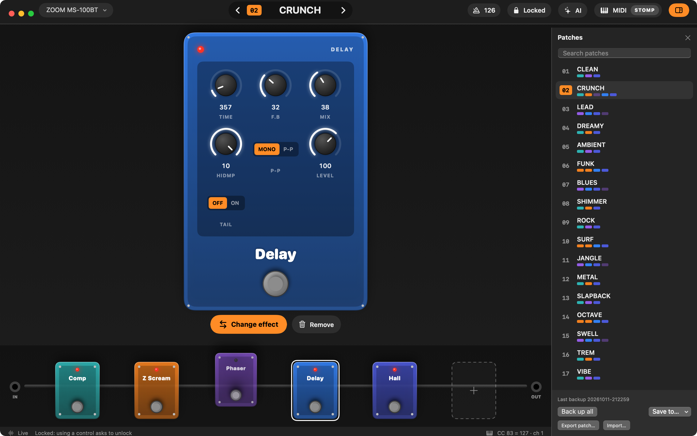
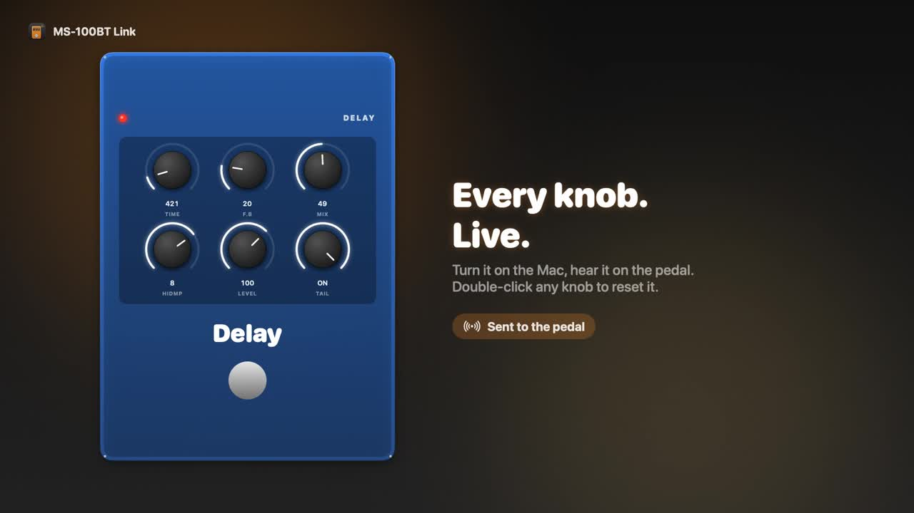
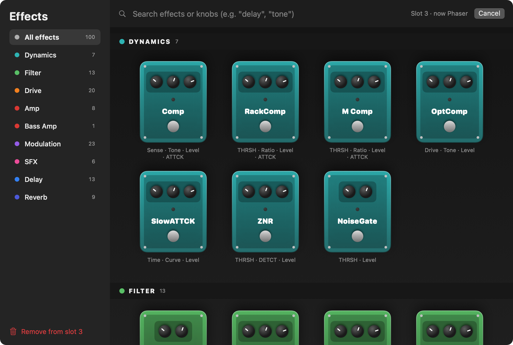
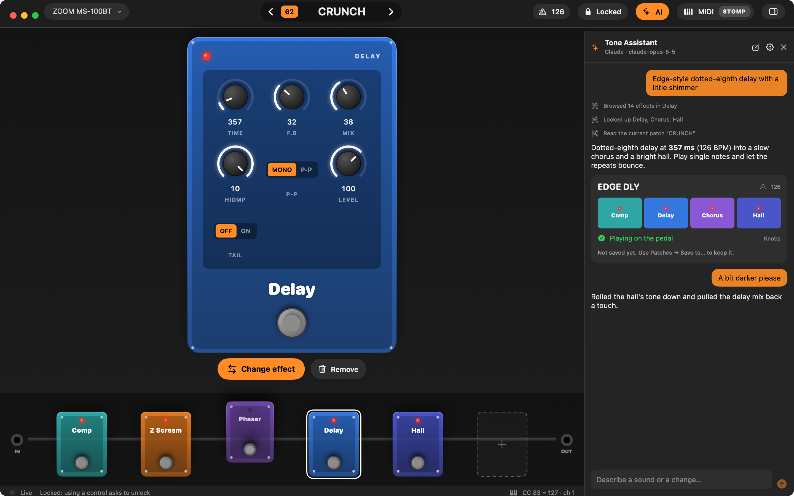
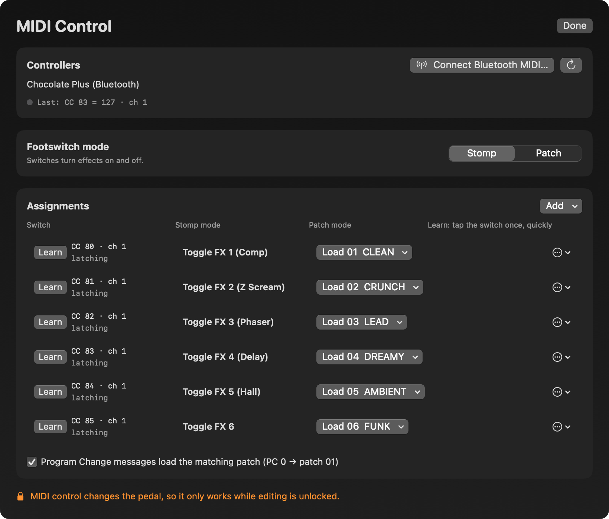

# MS-100BT Link

**A modern editor for the Zoom MS-100BT MultiStomp, on your Mac, over Bluetooth.**

Zoom only made an iPhone app for this pedal, and it disappeared years ago. MS-100BT Link brings the pedal back
to life: see your patches as a real pedalboard, turn knobs live, back up all 50 patches, drive it from a MIDI
footswitch, and describe a sound to an AI that builds the patch for you.



[](docs/media/promo.mp4)

▶ **[Watch the 47-second tour](docs/media/promo.mp4)**

> **Unofficial.** Not affiliated with or endorsed by Zoom Corporation. "Zoom" and "MultiStomp" are trademarks
> of their owners. Editing writes to your pedal, so back up first. The app never sends firmware or file-system commands.

---

## What it does

### A real pedalboard
Your patch is laid out as a signal chain: **IN → six stompboxes → OUT**. Each effect is drawn as a pedal in its
category's color, with an LED and a footswitch. Effects that are off lift off the cable and fade out. Click any pedal to
open it large, with knobs you drag up and down (double-click resets to the default) and switches for two-way settings.
The pedal's own screen follows along when you switch effects from the Mac.

### Live editing, both ways
Every change plays on the pedal instantly. Change something on the pedal itself and the app updates too (live updates
hold the pedal's edit mode and re-read the patch every couple of seconds). Rename patches, set the tempo, swap effects,
and remove them.

### 100 effects, one click away
The effect library shows every effect the MS-100BT has, drawn as mini stompboxes, grouped by category, and searchable by
name *or* knob ("tone", "decay").



### Describe a sound, get a patch
The **Tone Assistant** turns words into patches: *"Edge-style dotted-eighth delay with a little shimmer"*. It looks up the
pedal's real effects and allowed knob values, proposes a patch as a card, and you click **Try on pedal** to hear it.
"A bit darker" refines it. It works with **Claude**, **ChatGPT**, or any **OpenAI-compatible** service (Ollama, LM Studio,
OpenRouter) using your own API key, which is stored in the macOS Keychain. Nothing is saved on the pedal until you save it.



### Stomp with any MIDI footswitch
Pair a Bluetooth MIDI footswitch right from the app (or plug in USB), click **Learn**, and press a switch.
**Stomp mode** turns effects on and off; **Patch mode** loads patches (choose per switch). Momentary and latching
switches are detected automatically, and expression pedals can drive any knob.



### Your patches, safe
**Back up all 50** patches to your Mac, load any patch, save edits into a slot (only after a backup, with a confirmation
that names what gets overwritten), and import or export `.syx` patch files.

## Install

1. Download **MS-100BT-Link-v0.2.zip** from [Releases](../../releases/latest), unzip it, and move the app to Applications.
2. The app isn't notarized (that needs a paid Apple developer account), so the first time, **right-click → Open**,
   or allow it in *System Settings → Privacy & Security*.
3. On the pedal: **knob 1 → MENU → Bluetooth → PAIRING**. Then click **Connect** in the app and allow Bluetooth access.

Requires macOS 14 or later. Tested with an MS-100BT on firmware 1.30.

## Safety by design

- **A hard allowlist.** Every byte sent to the pedal passes an exact-shape allowlist in the transport layer: identity,
  patch read, edit mode, patch select, parameter edit, a validated 146-byte patch, and store. Firmware and file-system
  commands are blocked outright.
- **Validated patches.** A patch is only sent if every effect is known and every knob value is in range, and the app
  reads it back to confirm.
- **An editing lock.** Changing the pedal needs an explicit unlock with a warning. Saving to a slot needs a backup of
  that slot and a confirmation.
- **The AI can't touch bytes.** The assistant works through typed tools and only *proposes*; you try and save.

How the protocol was worked out, and every finding verified on real hardware:
[docs/updater-findings.md](docs/updater-findings.md).

## Build from source

```bash
cd MS100BTLink
swift test                 # protocol, codec, allowlist, assistant tests
./scripts/make-apps.sh     # build/MS-100BT Link.app and build/zoomprobe.app
```

Developer notes (allowlist table, the read-only `zoomprobe` CLI, MIDI, AI internals) are in
[MS100BTLink/README.md](MS100BTLink/README.md). The screenshots are rendered by the app itself
(`MS100BTLinkApp --screenshots docs/media`), and the promo video by [promo/](promo/): the frames come from the app's
own drawing code and the soundtrack is synthesized from scratch.

## Roadmap

- **More platforms:** Android phones and tablets, plus iPhone/iPad where Apple's accessory rules allow, built with Flutter on a shared core.
- **An effect library to download from**, with the AI able to suggest effects from it (see the project issues).

## Credits

- Effect names and parameter tables: [zoom-explorer](https://github.com/thammer/zoom-explorer) by Thomas Hammer (MIT);
  see [THIRD_PARTY_NOTICES.md](MS100BTLink/THIRD_PARTY_NOTICES.md).
- MultiStomp message reference: [zoom-ms-utility](https://github.com/multistomp/zoom-ms-utility) (g200kg).

## License

[MIT](LICENSE) © 2026 Anthony Essaye ([anthonyessaye@outlook.com](mailto:anthonyessaye@outlook.com)). Reuse it freely.
Bundle identifier: `com.anthonyessaye.ms100bt`.
